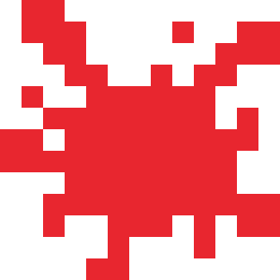
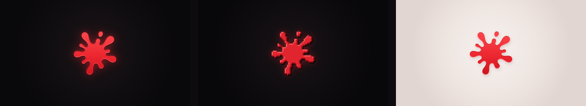
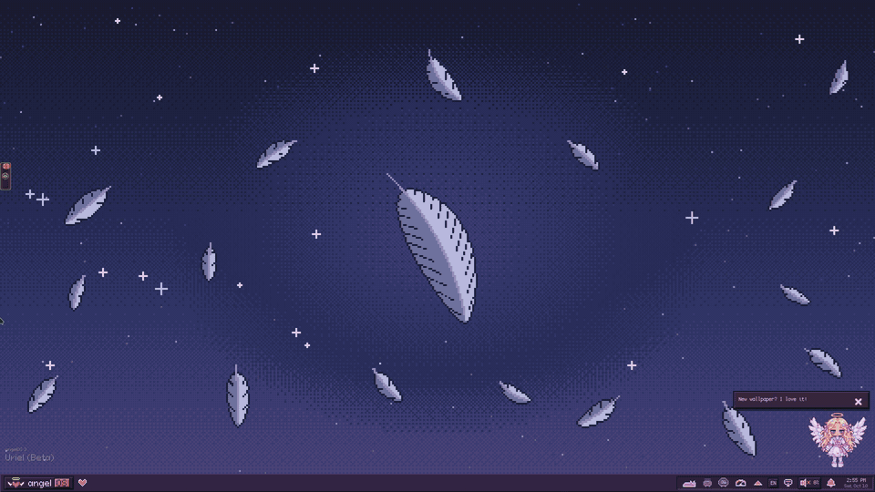
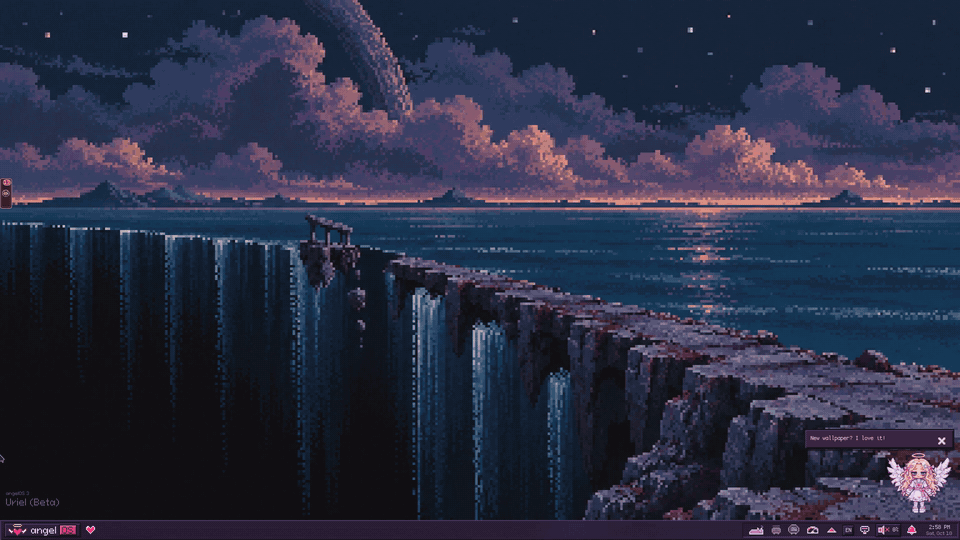
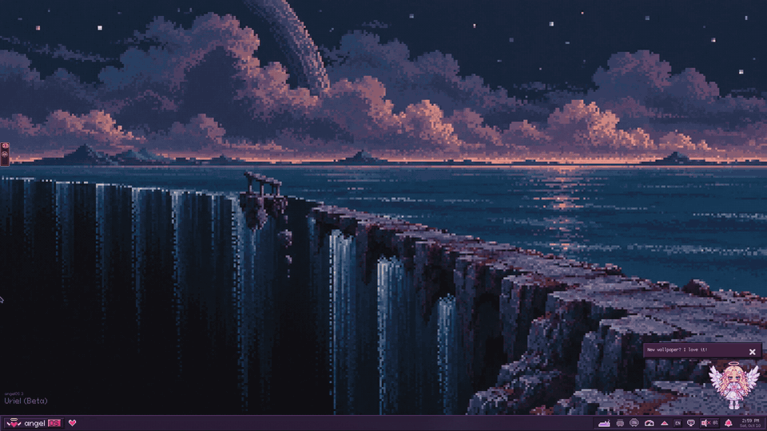
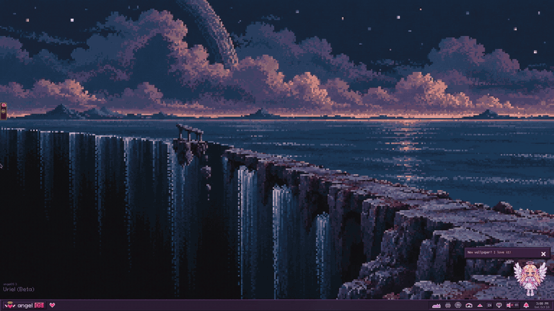
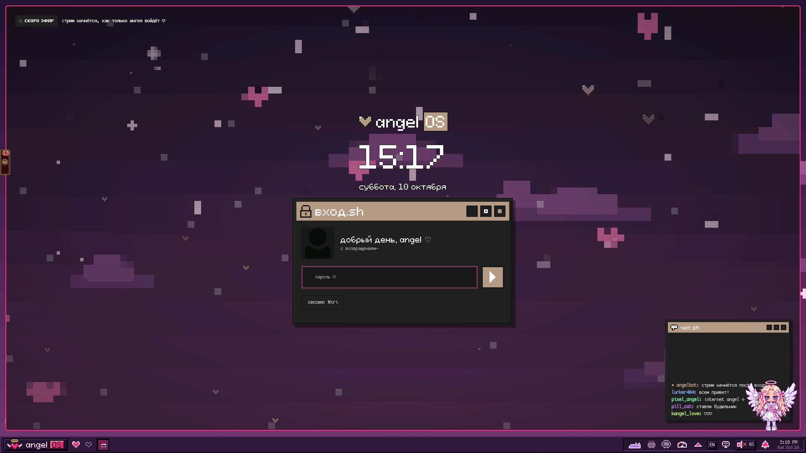

<p align="center">
  
</p>

# TrollOS

**TrollOS** — сборка рабочего стола для CachyOS / Arch на [Niri](https://github.com/YaLTeR/niri) с оболочкой на Quickshell.
Это форк [**AngelOS-Dotfiles**](https://github.com/MixaDoDs/AngelOS-Dotfiles) от **MixaDoDs**: всё, что ниже раздела «angelOS», — его работа,
TrollOS добавляет свой вид, исправления и несколько плагинов.

*TrollOS is a fork of [AngelOS-Dotfiles](https://github.com/MixaDoDs/AngelOS-Dotfiles) by MixaDoDs (MIT) — a Niri + Quickshell rice
with its own splat logo, wallpapers, fixes and extra plugins. The original documentation follows below.*

<p align="center">
  
</p>

## Чем TrollOS отличается от angelOS

- **Логотип** — красная клякса вместо ангельского сердечка (на панели, в Пуске, на экране загрузки), надпись «TrollOS».
- **Обои** — `Pictures/wallpapers/TrollOS/`: тёмные (по умолчанию), пиксельные и светлые, 4K.
  Нарисованы скриптом `scripts/trollos/make-wallpapers.py`.
- **Раскладки рабочего стола** — Настройки → Раскладки: Windows 11, macOS, Ubuntu, ChromeOS и другие пресеты панели.
- **Вид Windows 11** — панель, Пуск, Alt+Tab, «Ножницы» для скриншотов.
- **Док** (снизу или слева) и **оверлей** (Mod+G: заметки, гифки, видео поверх окон).
- **Скриншоты как в ShareX** (`~/.local/bin/angelos-shot`, Mod+Shift+S / Print): экран замирает, пометки, OCR, закрепление.
- **Исправления**: быстрее анимация окон (140 мс вместо 280), игровой режим не выключает анимации и быстрее возвращает эффекты,
  CS2 и игры Steam сразу открываются на весь экран, мелкие правки виджетов и настроек.

### Плагины TrollOS

Лежат в `.config/quickshell/angelos/plugins/`, включаются в Настройки → Плагины.

| Плагин | Что делает |
|---|---|
| `caffeine` | Чашка на панели: экран не гаснет и ПК не засыпает. Mod+Alt+C — вкл/выкл |
| `power-mode` | Энергосбережение / баланс / производительность прямо с панели (нужен `power-profiles-daemon`) |
| `emoji-panel` | Mod+. — эмодзи, каомодзи, символы и история буфера, как Win + . |
| `close-confirm` | Mod+Q в окне с `claude` или `codex` сначала спрашивает; Mod+Ctrl+Q — закрыть сразу |
| `dynamic-island` | Клик по строке песни на панели — «остров»: трек, перемотка, текст; файлы на телефон через KDE Connect, экран телефона через scrcpy |
| `friend-runner` | Друг заходит в Discord — по панели пробегает человечек с его аватаркой |
| `panel-shooter` | Пистолет у трея: тир по человечкам на панели |

`friend-runner` (и друзья в `panel-shooter`) работают через плагин для Discord-клиента Equicord — он в
[`extras/equicord/`](extras/equicord/), ставится командой `sh extras/equicord/install.sh`.

## Установка

```sh
git clone https://github.com/Flenstick/TrollOS-Dotfiles.git
cd TrollOS-Dotfiles
./install.sh
```

Установщик тот же, что у angelOS — все его переключатели описаны ниже.

## Лицензия и авторы

- Оригинал: © 2026 MixaDoDs, MIT — [`LICENSE`](LICENSE).
- Изменения TrollOS: © 2026 Flenstick, тоже MIT.
- Чужие шрифты, иконки, тема SDDM и прочее — со своими лицензиями, список в [`THIRD-PARTY.md`](THIRD-PARTY.md).
- Плагин для Equicord (`extras/equicord/angelosFriends`) — GPL-3.0-or-later, как и сам Equicord.

---

<div align="center">

# ♡ PixelStreetArt ✧ angelOS ♡

**`~ welcome back, internet angel ~`**

A pixel-pink **CachyOS + [Niri](https://github.com/YaLTeR/niri)** rice with its own desktop shell, **angelOS**,
built on [Quickshell](https://quickshell.org) in the spirit of *NEEDY GIRL OVERDOSE*:
Win98 windows, pixel hearts, a bar that sings along, and a desktop you can right-click like it's 2001.


 

*`overdose` (dark) ✧ `angel` (light) — one click apart.*

</div>

> [!NOTE]
> The desktop screenshots and GIFs show angelOS in use. Wallpaper, widget placement, language and theme are configurable; the first-run wizard helps you choose your setup. The helper-tools illustration and SDDM test preview are labelled separately below.
> In a nested session Niri uses `Alt` as `Mod`; on real hardware `Mod` is the **Super / Windows** key, and that is what the tables use.

**Jump to:** [angelOS.exe](#-angelosexe) · [Plugins](#-pluginsexe) · [Tiling](#-tilingexe) · [Keybindings](#-keybindings) · [Helper tools](#-helper-tools) · [Install](#-installation) · [Login screen](#-login-screen-sddm) · [Keyboard](#-keyboard-layouts) · [Mouse & monitors](#-mouse-and-monitors) · [Layout](#-repository-layout)

---

## ✧ angelOS.exe

angelOS is the whole desktop: bar, wallpaper, widgets, launcher, notifications, OSD, lock screen, polkit dialogs, clipboard history and a settings app. It lives in [`.config/quickshell/angelos`](.config/quickshell/angelos) and is plain QML, so everything is hackable.

### ♡ desktop.exe

The taskbar is a Win98 one with pixel hearts for workspaces (or the icons of the apps on them), window buttons, a tray recoloured to the theme, and the **current lyric line of the song in the middle** (synced lyrics from [lrclib.net](https://lrclib.net)). Widgets sit on the wallpaper. Light and dark palettes include `bubblegum`, `overdose`, `cyber angel`, Gruvbox, Rosé Pine, Catppuccin and colours generated from your wallpaper.


| Keys | Action |
| --- | --- |
| `Mod`+`Alt`+`T` | Light ⇄ dark theme |
| `Mod`+`Alt`+`Y` | Hide / show the lyrics line |
| `Mod`+`Mouse wheel` on the hearts | Switch workspace |
| Right-click a window button | Close that window |

### ♡ wallpaper.exe

Changing the wallpaper plays a pixel transition: mosaic plus ordered (Bayer) dither. It only plays when the picture changes; switching workspaces stays instant, even with a wallpaper per workspace.



`Mod`+`Shift`+`Return` opens the wallpaper picker (Settings → Wallpaper): one for every screen, one per monitor, or one per workspace.

### ♡ menu.exe

Right-click the wallpaper for a **Windows 11-style** menu: quick actions on top, then **View ▸** (toggle widgets, edit mode, snap to grid), **New ▸** (text note, screenshot, recording), **Open ▸** (your folders), display settings, personalisation, "Open in Terminal", and **Show more options ▸** for plugin items.


Widgets (`clock.exe`, `sysmon.exe`, `cava.exe`, `music.exe`, plus plugin ones) are dragged by their title bar; double-click a title for edit mode. Settings → Widgets adds them to any monitor, moves them between monitors and sets their options (e.g. which output `cava` listens to).

### ♡ launcher.exe

`Mod`+`Space`. Fuzzy app search that learns what you launch, `web …` to search the web or open favourite sites, `claude …` / `claude ? …` for Claude Code, and `> command` to run anything in `sh`.



| Keys | Action |
| --- | --- |
| `Mod`+`Space` | Launcher |
| `Mod`+`V` | Clipboard history |
| `Mod`+`S` / `Mod`+`Alt`+`S` | Settings |
| `Mod`+`Alt`+`L` | Lock screen |
| `Mod`+`Shift`+`Q` | Power menu (lock, sleep, log out, reboot, power off) |

### ♡ settings.exe

A real window with pages for Appearance, Wallpaper, **Widgets**, Bar (drag-and-drop layout like Noctalia's, hearts or app icons, window-button widths, tray icon colours), Workspaces, Lyrics, Monitor (drag the screens around, writes `monitor.kdl`), Keyboard & mouse, **Windows** (default width, `Mod`+`R` presets, a width per app), Sound, **Default apps** (browser, editor, files, terminal, media…), Notifications, Plugins and System. Changes to Niri's config are backed up, checked with `niri validate` and rolled back if Niri says no.



### ♡ tips.exe

The first login opens a short setup wizard (monitors, keyboard, theme, bar, windows, desktop, default apps) and then **interface tips**: each part of the screen is circled in pixels and explained. Replay them any time from Settings → Appearance.


### ♡ from a terminal

Everything is scriptable through the `angelos` command:

```bash
angelos help                       # every function
angelos theme toggle               # dark <-> light
angelos flavor overdose            # bubblegum | overdose | cyberangel
angelos wallpaper random           # or a path
angelos bar island                 # taskbar | top | island
angelos widget cava DP-1           # toggle a desktop widget on a monitor
angelos settings windows           # open a settings page
angelos tour                       # interface tips
angelos switch noctalia            # go back to Noctalia (and `switch angelos` to return)
```

---

## ✧ plugins.exe

A plugin is a folder with a `manifest.json`; it can add right-click menu items, bar widgets, desktop widgets, launcher providers, a settings page and a background service. **Settings → Plugins → New plugin** scaffolds one; the guide is [`docs/PLUGINS.md`](.config/quickshell/angelos/docs/PLUGINS.md).

**Build a plugin with AI:** enable **Settings → System → Developer mode**, then open
**Plugin Studio** from Settings or Start. Add an OpenAI or Anthropic API key,
describe your idea, answer any questions and approve the proposed behavior and
size. Studio generates themed QML, shows the files and checks their syntax before
you click **Install**. Installed plugins appear in the normal plugin settings;
desktop widgets can be added to the current screen immediately. The UI supports
Russian and English. [Plugin Studio guide](.config/quickshell/angelos/docs/PLUGIN_STUDIO.md).

| Plugin | What it does |
| --- | --- |
| `cat` | A pixel cat on the bar: asleep, walking or running with the CPU load |
| `speedtest` | Internet speed test with a pixel speedometer and history |
| `web-search` | `web …` in the launcher: search engines and favourite sites with favicons |
| `claude-companion` | How much of your Claude plan is left (5-hour and weekly, like `/usage`), live Claude Code sessions found on their own, `claude.exe` on the desktop, `claude …` in the launcher, an MCP bridge to the desktop |
| `nightlight` | Warm screen in the evening via `wlsunset` (6600 K → 3900 K) |
| `stream-stats` | NGO-style `stats.exe`: stress = CPU, darkness = RAM, love = uptime (off by default) |
| `quick-actions` | Extra right-click items (off by default) |

---

## ✧ tiling.exe

Windows live in columns on an infinite horizontal strip. New windows open to the right, focus scrolls the view, and columns can be resized, centred, stacked, turned into tabs, or popped out as floating windows. Settings → Windows sets the default width, the `Mod`+`R` presets and a width per app.



| Keys | Action |
| --- | --- |
| `Mod`+`H` / `Mod`+`L` (or arrows) | Focus column left / right |
| `Mod`+`Ctrl`+`H` / `L` | Move column left / right |
| `Mod`+`R` | Cycle preset column widths |
| `Mod`+`C` | Centre column |
| `Mod`+`[` / `Mod`+`]` | Pull a window into the neighbouring column, or push it out |
| `Mod`+`W` | Toggle tabbed column |
| `Mod`+`Shift`+`Space` | Toggle floating |
| `Mod`+`F` / `Mod`+`Shift`+`F` | Fullscreen / maximise column |

### overview.exe

`Mod`+`Tab` zooms out to every workspace at once. Workspaces are dynamic and vertical, so you can send a column to the next one and jump straight back. The wallpaper stays in the overview backdrop.


| Keys | Action |
| --- | --- |
| `Mod`+`Tab` | Toggle overview |
| `Mod`+`1`…`9` | Go to workspace |
| `Mod`+`Ctrl`+`1`…`9` | Move column to workspace |
| `Mod`+`Mouse wheel` | Switch workspace |
| `Mod`+`O` | Previous workspace |

### hotkeys.exe

Forgot a binding? `Mod`+`Shift`+`Esc` opens Niri's hotkey overlay. Every important bind carries a readable title, so the overlay doubles as documentation.


---

## ✧ Keybindings

Full list lives in [`.config/niri/cfg/keybinds.kdl`](.config/niri/cfg/keybinds.kdl).

| Keys | Action |
| --- | --- |
| `Mod`+`T` | Terminal (kitty) |
| `Mod`+`B` | Default browser (`xdg-open`) |
| `Mod`+`E` | File manager (Nautilus) |
| `Mod`+`Q` | Close window |
| `Mod`+`Space` | angelOS launcher |
| `Mod`+`V` | Clipboard history |
| `Mod`+`S` / `Mod`+`Alt`+`S` | angelOS settings |
| `Mod`+`Shift`+`Return` | Wallpaper picker |
| `Mod`+`Alt`+`L` | Lock screen |
| `Mod`+`Shift`+`Q` | Power menu |
| `Mod`+`Alt`+`Y` | Lyrics on / off |
| `Mod`+`Alt`+`T` | Light / dark theme |
| `Mod`+`Shift`+`S` | Screenshot a region |
| `Mod`+`Shift`+`T` | OCR a region to the clipboard |
| `Mod`+`Shift`+`R` | Start / stop region recording |
| `Mod`+`Shift`+`V` | Toggle voice dictation |
| `Mod`+`Shift`+`X` | Toggle screencast privacy mode |
| `Ctrl`+`Shift`+`2` / `3` | Screenshot the screen / the window |
| `Mod`+`Shift`+`P` | Turn monitors off |
| `Mod`+`Shift`+`←→↑↓` | Focus another monitor |
| `Mod`+`Esc` | Emergency escape: release a keyboard-shortcuts inhibitor from a fullscreen app |
| `Ctrl`+`Alt`+`Delete` | Quit Niri |

Media and volume keys are wired to `angelos …` (a small pixel OSD shows the level) and keep working on the lock screen.

---

## ✧ Helper tools

Installed to `~/.local/bin`. They are plain Bash/Python scripts built on `grim`, `slurp`, `wf-recorder`, `tesseract` and `wl-clipboard`.


*The image above is a safe repository mockup of the tools.*

| Command | What it does |
| --- | --- |
| `niri-screenshot-region` | Region screenshot with a pixel "gravity ropes" selection overlay; always saves to `~/Pictures/Screenshots` |
| `niri-record-region` | Toggle a region recording to `~/Videos` with an on-screen overlay. Tune it with `NIRI_RECORD_FPS`, `NIRI_RECORD_CODEC`, `NIRI_RECORD_CRF` |
| `niri-ocr` | Select a region and copy the recognised text to the clipboard. Uses every installed Tesseract language pack; the installer adds packs for your keyboard layouts |
| `niri-cast-privacy` | Toggle Niri `block-out-from "screencast"` rules for Telegram, Bitwarden, Helium and Discord. Your screen stays live, the stream sees black |
| `niri-game-mode` | User service that switches off animations, blur and transparency while a window covers an output, then restores them |
| `voxtype-indicator` | The classic dictation indicator for [Voxtype](https://github.com/peteonrails/voxtype); angelOS shows its own pixel `voice.exe` instead (Settings → Sound) |

The `tech` install profile installs the lighter `niri-screenshot-region-simple` and `niri-record-region-simple` in place of the overlay versions.

---

## ✧ What is included

- **angelOS**, the Quickshell desktop shell above, with its plugins and theme templates for kitty, foot, Alacritty, GTK 3/4 and Niri's focus ring.
- Niri configuration split into small, readable KDL files (`layout`, `animation`, `rules`, `input`, `keybinds`, `autostart`, …).
- Noctalia as an alternative shell, and a shell-free fallback config.
- An SDDM login screen: the animated [`pixel-cyberpunk`](#-login-screen-sddm) theme, installed and enabled for you.
- Kitty, Alacritty, Foot, GTK, Fastfetch and fontconfig setups, themed to match.
- The `pixora` pixel icon theme, Cozette / Pixeloid pixel fonts and the wallpaper packs you pick.
- Package lists for Arch-based systems.
- An installer that asks which shell and keyboard layouts you want, backs up anything it replaces, and is safe to re-run.

## ✧ Requirements

- Arch Linux or CachyOS
- A Wayland session
- `sudo` for the optional package step
- `git` and `curl`

`install.sh` installs Niri and the rest of the rice from `packages/pacman.txt`, angelOS's own packages from `packages/angelos.txt` (`quickshell`, `cava`, `wlsunset`, `speedtest-cli`, …) and SDDM from `packages/sddm.txt`, with `sudo pacman -Syu --needed`, so the system is brought up to date in the same step: Arch does not support partial upgrades, and a plain `pacman -S` against a stale package database fails halfway. It does not install browsers, chat clients, games, development tools, or unrelated personal applications. No AUR packages are required.

The helper scripts use `grim` and `slurp` (screenshots), `wf-recorder` (recording), `tesseract` and `wl-clipboard` (OCR), Python GTK, Cairo and GtkLayerShell (overlays), and `voxtype` with the `large-v3-turbo` Whisper model (voice input).

## ✧ Installation

```bash
git clone https://github.com/Flenstick/TrollOS-Dotfiles.git
cd TrollOS-Dotfiles
./.install
```

`./install.sh` is the same installer; `.install` is just a convenient entry point. Run without arguments it walks you through a short setup (English, or Russian when your locale is `ru_*`):

1. **Profile**: `full` (styling, a desktop shell, pixel fonts and icons, wallpapers) or `tech` (Niri config and helper tools only).
2. **Shell**: **angelOS** (default), Noctalia, or none.
3. **Wallpapers**: which packs to download from [PixelStreetArt_Wallpapers](https://github.com/MixaDoDs/PixelStreetArt_Wallpapers) — Lain (~410 MB), Pixel (~187 MB), green pixel art (~275 MB), all or none. Only the chosen folders are fetched.
4. **Voice input**: whether to install Voxtype and its ~1.6 GB Whisper model.
5. **Login screen**: whether to install SDDM with the `pixel-cyberpunk` theme and make it the login manager.
6. **Keyboard layouts**: pick from a list or type any XKB code.
7. **Layout switch shortcut**: Alt+Shift, Ctrl+Shift, Caps Lock, Right Alt or Left Alt.

On the first login angelOS opens its setup wizard and then the interface tips by itself.

Everything can also be given up front, which makes the installer fully unattended:

```bash
DOTFILES_MODE=full DESKTOP_SHELL=angelos \
KB_LAYOUTS="us ru" KB_TOGGLE=alt_shift \
WALLPAPER_PACKS=Lain,Pixel INSTALL_VOXTYPE=1 DOWNLOAD_VOXTYPE_MODEL=1 \
./install.sh
```

Other switches (run `./install.sh --help` for the full list):

```bash
SKIP_PACKAGES=1 ./install.sh                                  # config only: no pacman, no SDDM, no sudo
DESKTOP_SHELL=noctalia ./install.sh                           # Noctalia instead of angelOS
DESKTOP_SHELL=none ./install.sh                               # plain Niri, no shell
INSTALL_SDDM=0 ./install.sh                                   # keep your current login manager
INSTALL_VOXTYPE=0 DOWNLOAD_VOXTYPE_MODEL=0 ./install.sh       # no voice input
ENABLE_SERVICES=0 ./install.sh                                # do not enable user services
WALLPAPER_PACKS=none ./install.sh                             # no wallpaper packs (all | none | Lain,Pixel,…)
```

`NOCTALIA=1` / `NOCTALIA=0` from earlier versions still work and mean `DESKTOP_SHELL=noctalia` / `none`.

Existing files are never overwritten silently: they are moved to `filename.bak.YYYYMMDD-HHMMSS`. Re-running the installer leaves unchanged files alone, and files that belong to you (`monitor.kdl`, the XDG user-dirs files) are only created if missing.

Run the repository check before installing. Besides syntax and hygiene checks it runs the installer against throw-away home directories, so it never touches your real configuration:

```bash
./scripts/check.sh
```

<details>
<summary>♡ Prefer Noctalia?</summary>

`DESKTOP_SHELL=noctalia ./install.sh` installs [Noctalia](https://docs.noctalia.dev/) with its preconfigured setup ([`.config/noctalia/config.toml`](.config/noctalia/config.toml)) and rewires Niri for it. On an angelOS install, `angelos switch noctalia` does the same in place and `angelos switch angelos` goes back.


</details>

## ✧ Updating

With angelOS: **Settings → Updates** checks the repository you installed from, shows what is new and, on a click, runs `git pull` and the installer without packages (a snapshot of your configs is taken first). It can also check once a day and only notify you.

Installs made before this page existed need one manual update to get it:

```bash
cd PixelStreetArt_Dotfiles_Niri
git pull
./install.sh
```

A running angelOS keeps the previous version in memory: the installer offers to restart it, or run `angelos restart` (logging out and back in works too).

## ✧ Login screen (SDDM)

The installer sets up [SDDM](https://github.com/sddm/sddm) with **pixel-cyberpunk**, an animated pixel-art theme from [Qylock](https://github.com/Darkkal44/qylock) by Darkkal44: a looping video background, a pixel font, clock, user and session switchers, reboot and shutdown buttons.



*Rendered by the real greeter (`sddm-greeter-qt6 --test-mode`) with a placeholder user; the background is a looping pixel-art video.*

What `INSTALL_SDDM=1` (the default) does:

1. Installs `sddm` and exactly the Qt modules the theme imports (`packages/sddm.txt`): without `qt6-5compat` the theme cannot load at all, and without `qt6-multimedia-ffmpeg` the background stays black.
2. Copies the theme to `/usr/share/sddm/themes/pixel-cyberpunk` (world-readable, since the greeter runs as the `sddm` user).
3. Selects it in `/etc/sddm.conf.d/zz-pixelstreetart.conf`. A `Current=` theme in `/etc/sddm.conf`, which SDDM reads last and which would override the drop-in, is commented out with a backup.
4. Enables `sddm.service`. If another login manager (GDM, LightDM, ly, greetd, …) is enabled it asks before switching; unattended runs only switch when you pass `INSTALL_SDDM=1` explicitly.
5. Makes sure the machine boots into `graphical.target`, the only target that starts a login manager.

The session button in the top-right corner (`NIRI` above) cycles through installed sessions when clicked; SDDM remembers the last one you used.

Preview the theme without logging out:

```bash
sddm-greeter-qt6 --test-mode --theme /usr/share/sddm/themes/pixel-cyberpunk
```

### SDDM does not start

| Symptom | Cause and fix |
| --- | --- |
| Boots to a text console | No login manager is enabled, or the boot target is `multi-user.target`. Re-run the installer, or: `sudo systemctl enable --force sddm && sudo systemctl set-default graphical.target` |
| `Failed to enable unit … display-manager.service already exists` | Another login manager owns the slot: `sudo systemctl disable gdm` (or `lightdm`, `ly@tty2`, `greetd`), then enable SDDM as above |
| Plain grey/blue SDDM instead of the pixel theme | The theme is not selected or cannot load. Check `grep -r Current= /etc/sddm.conf /etc/sddm.conf.d/` and install `qt6-5compat` |
| Theme loads but the background is black | Missing video backend: `sudo pacman -S qt6-multimedia qt6-multimedia-ffmpeg` |
| Anything else | `journalctl -b -u sddm` shows the greeter's errors |

To go back to another login manager: `sudo systemctl disable sddm && sudo systemctl enable <other>`.

## ✧ Keyboard layouts

The installer writes your choice into [`~/.config/niri/cfg/input.kdl`](.config/niri/cfg/input.kdl), so nobody has to hunt for it:

```kdl
xkb {
    layout "us,ru"
    options "grp:alt_shift_toggle"
}
```

| Choice | Shortcut | XKB option |
| --- | --- | --- |
| Alt + Shift | `KB_TOGGLE=alt_shift` (default) | `grp:alt_shift_toggle` |
| Ctrl + Shift | `KB_TOGGLE=ctrl_shift` | `grp:ctrl_shift_toggle` |
| Caps Lock | `KB_TOGGLE=caps` | `grp:caps_toggle` (Caps Lock itself stops working) |
| Right Alt | `KB_TOGGLE=ralt` | `grp:ralt_toggle` |
| Left Alt | `KB_TOGGLE=lalt` | `grp:lalt_toggle` |

Win+Space is deliberately not offered because `Mod`+`Space` opens the launcher. Any other XKB option can be passed as `KB_TOGGLE=grp:shifts_toggle`.

Your layouts also drive two other things: the **dictation language** of Voxtype (the first non-English layout, e.g. `ru` → Russian) and the **OCR language packs** that get installed.

Later, change layouts in angelOS (Settings → Keyboard & mouse) or edit `input.kdl`; Niri reloads it instantly. `niri msg keyboard-layouts` shows what is active.

## ✧ Mouse and monitors

- **Mouse**: pointer speed and acceleration start at libinput defaults, because every mouse is different. Tune them in Settings → Keyboard & mouse, or with a `mouse { accel-profile "adaptive"; accel-speed 0.4 }` block in `input.kdl`.
- **Focus indicator**: the focused window gets a thin outline in the angelOS accent colour, and it follows the theme. Windows stay fully opaque, with no blur and no inactive dimming.
- **Square decorations**: windows and popups use zero corner radius. GTK 3/4 window frames, title bars, menus and dialogs follow the same angular style through the angelOS theme templates.
- **Monitors**: `~/.config/niri/monitor.kdl` is created empty, so Niri auto-detects your outputs. Set resolution, refresh rate, scale, rotation and position in Settings → Monitor (drag the screens into place); it writes that file with a backup, and the installer never overwrites it.

### After installation

Review and adjust for your system:

```text
~/.config/niri/cfg/keybinds.kdl
~/.config/niri/cfg/misc.kdl
~/.config/angelos/settings.json     (written by angelOS's settings app)
```

- The default binds expect `kitty`, a browser registered with `xdg-open`, `nautilus` and several Wayland utilities. Replace those commands, or pick defaults in Settings → Default apps.
- Voxtype is downloaded from its official GitHub release and verified with a pinned SHA256 checksum. Its binary and Whisper model stay outside the repository.

## ✧ Repository layout

```text
.config/quickshell/angelos/  angelOS: the shell, its plugins, templates and docs
.config/                     Niri, Noctalia, Voxtype, terminal, GTK and fastfetch configuration
.local/bin/                  Wayland helper scripts
.local/share/                Optional icon theme and pixel fonts
Pictures/                    The three default wallpapers (the packs live in PixelStreetArt_Wallpapers)
packages/                    Arch, AUR and Flatpak package lists (angelos.txt, sddm.txt)
sddm/                        SDDM pixel-cyberpunk theme and its config drop-in
scripts/check.sh             Repository check, including end-to-end installer tests
docs/screenshots/            Static preview images
docs/demo/                   GIFs used in this README
install.sh                   Installer with backups, profiles and a shell choice
```

## ✧ Notes

- No credentials, browser profiles, cookies, history, caches, keyrings or local runtime state are included. angelOS settings (`~/.config/angelos`) are yours and are not part of the repository.
- Wallpaper packs are a separate repository, [PixelStreetArt_Wallpapers](https://github.com/MixaDoDs/PixelStreetArt_Wallpapers); they are optional and can be removed without affecting the configuration.
- The `pixora` icon theme and pixel fonts are optional visual assets.
- angelOS draws only its own pixel decorations; no game art is included.
- Niri configuration syntax changes between releases; check the current Niri documentation if an option is rejected.

## ✧ License

No license file is currently included for the dotfiles themselves. Add one before redistributing the repository under a specific license.

The SDDM theme in `sddm/themes/pixel-cyberpunk/` is from [Qylock](https://github.com/Darkkal44/qylock) by Darkkal44 and is distributed unmodified under the GNU GPL v3 (see its `LICENSE`). Its font, Pixelify Sans, is under the SIL Open Font License. The `claude-companion`, `cat`, `speedtest` and `web-search` plugins are angelOS ports of MIT-licensed Noctalia plugins (credited in their manifests).

<div align="center">

`♡ thank you for watching the stream ♡`

</div>
